# Text

Text adds lettering to a [Sketch](../../02-concepts/sketches/index.md). Each letter is a closed outline, so [Extrude](../../05-modeling/extrude/index.md) turns it into raised letters and Extrude Cut engraves it. The text stays editable: change the words, font or Cap Height later, and every Feature built on it is rebuilt.

## When to use it

Use Text for part numbers, labels, name plates, signs, stamps and stencils. Text can go in any Sketch: on an Origin Plane, a Construction Plane or a flat face of a solid.

## Add text

1. While you edit a sketch, tap **Text** in the sidebar. If you don't see the drawing Tools, tap the pencil icon at the top of the sidebar.

   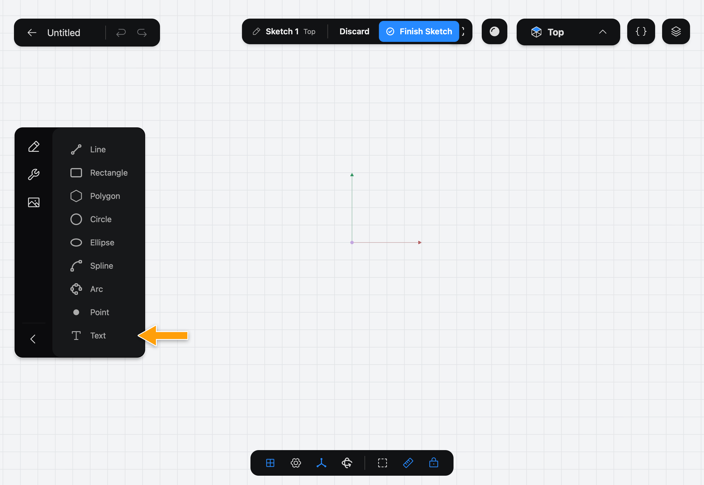

2. With the Pencil, tap where the text should start. The step bar at the top of the canvas becomes the **Text** bar. Type your text in its field. The letters appear in the Sketch as you type.

   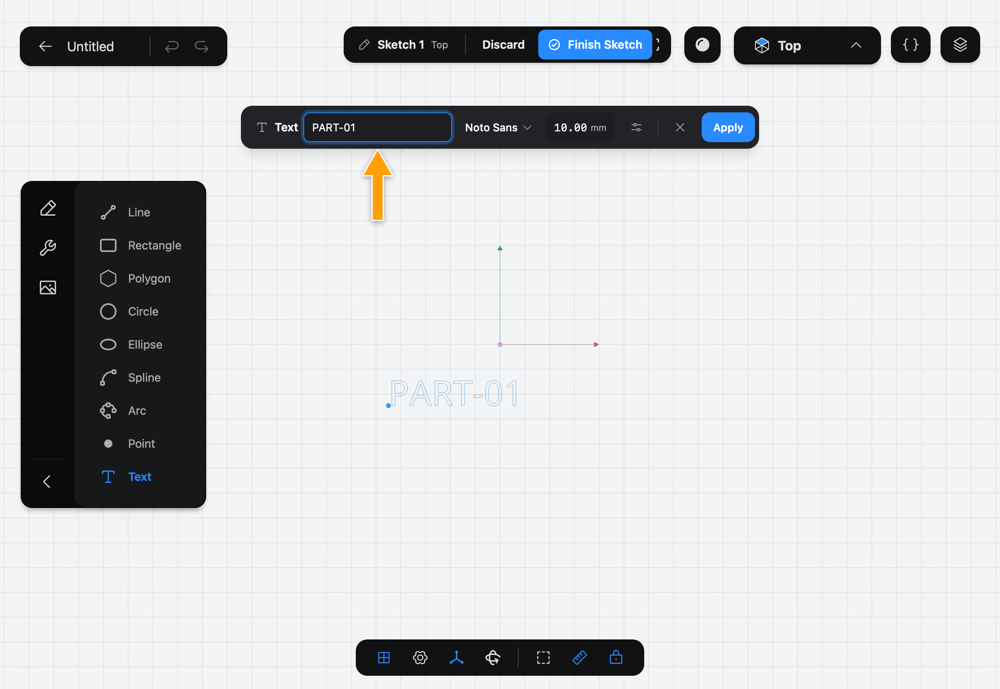

   The point you tapped is the text's **anchor**. A dashed line from it, the **baseline**, is the line the letters sit on.

3. Set **Cap Height**: how tall the capital letters are. Tap the value in the bar (it starts at 10.00 mm) and type a new one.

   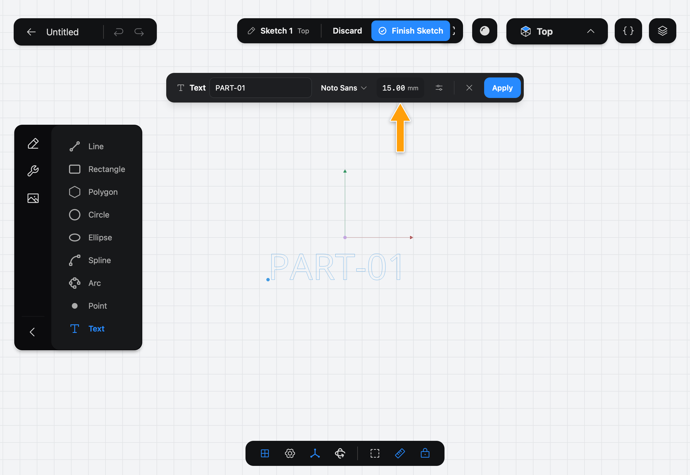

4. Pick a font: tap the font's name in the bar. The menu shows each font in its own face.

   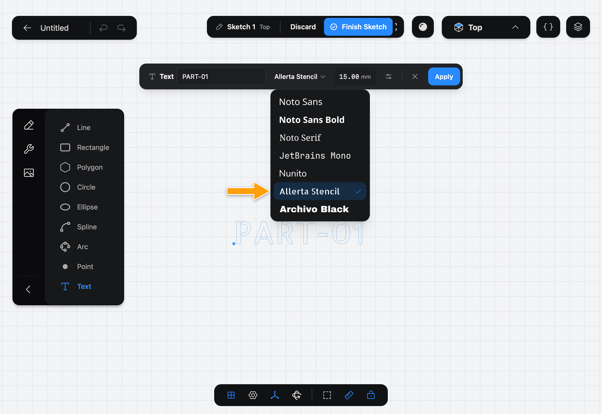

5. Tap **Apply**. The text is added to the Sketch, and the Tool stays open for the next text. Tap **Text** again, or press **Esc**, to put it away.

   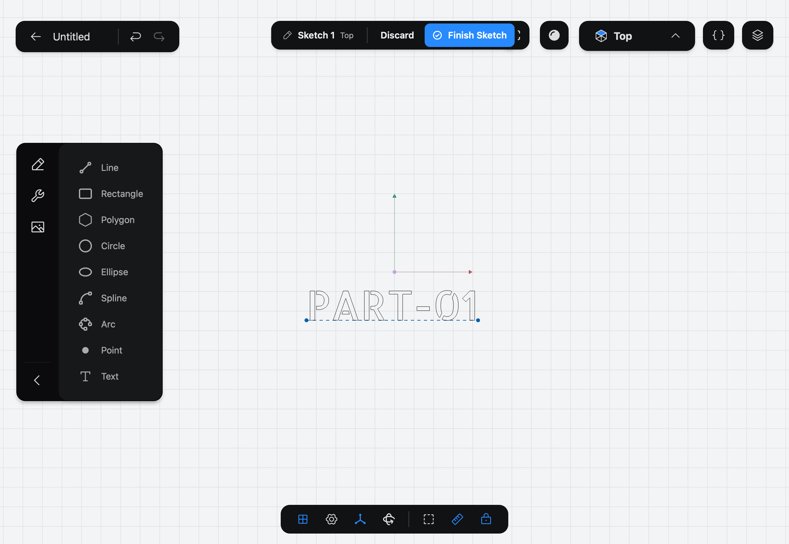

## Options

- **Text** can have several lines and up to 256 characters. Press **Return** to start a new line; the field grows to show three. Press **⌘-Return** to apply, and **Esc** to cancel.
- **Font** is one of the fonts that come with Part3D (see below).
- **Cap Height** is the height of a capital letter such as H, in the Document's units. It's what "8 mm lettering" means: set it to 8 and an H is 8 mm tall. Lowercase letters are shorter, and letters with tails, such as g and y, reach below the baseline. To take the value from a Parameter, tap the value and then the braces.

The next three are under **More**, the sliders button in the bar (on a narrow screen, Cap Height is there too):

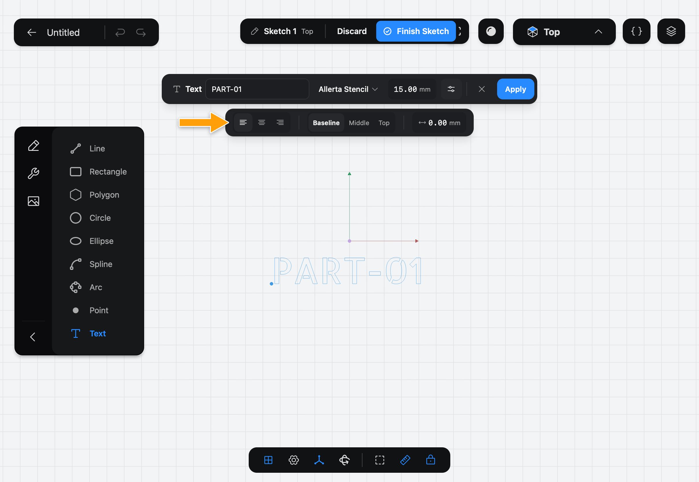

- **Alignment** puts the text to the right of the anchor (left-aligned), centered on it, or to its left (right-aligned).
- **Anchor** sets what the anchor is level with: the **Baseline**, the **Middle** of the capitals, or their **Top**. To center text on a point, pick center alignment and **Middle**.
- **Letter Spacing** adds space between the letters. It starts at 0.

The anchor and the baseline are ordinary sketch geometry: drag them to move or turn the text, and add Constraints and dimensions to them, for example to keep the text centered on a face. The letters themselves can't be selected, dimensioned or edited one by one.

## Change text

1. Double-tap the text, on its letters or its baseline. The **Text** bar opens with its values.

   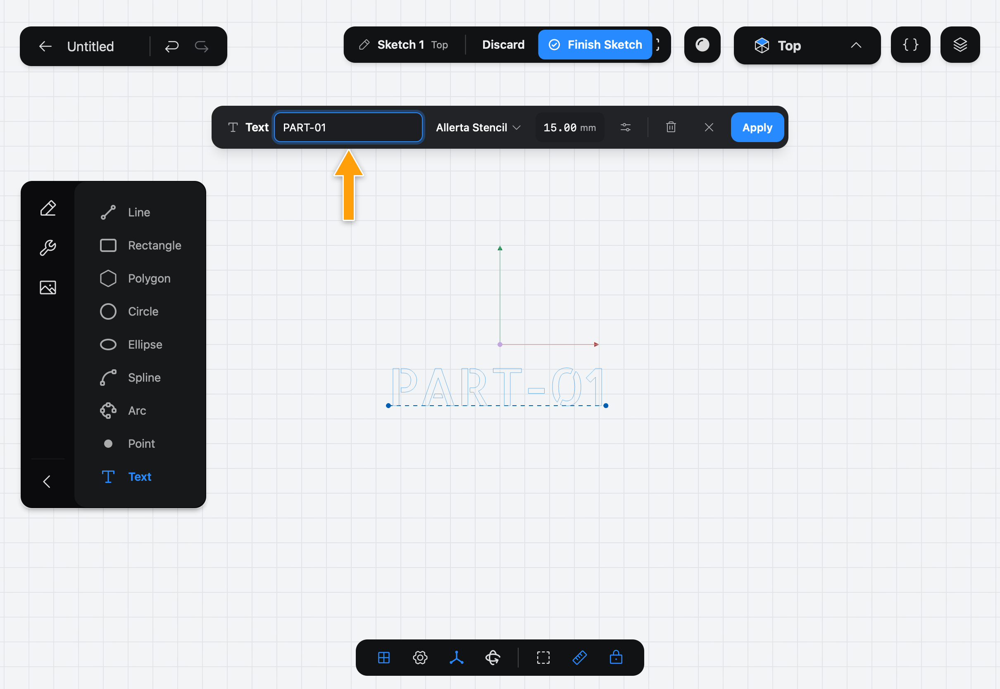

2. Change what you like and tap **Apply**. Features made from the text are rebuilt. To remove the text, tap the trash button in the bar.

If you change the words, faces that a later Feature picked on the letters stay picked as long as the letters before them didn't change.

## Fonts

| Font | Use it for |
|---|---|
| Noto Sans | Clear, everyday lettering. The default |
| Noto Sans Bold | Small text that has to stay readable when printed |
| Noto Serif | A classic, book-like look |
| JetBrains Mono | Codes and serial numbers, with equal-width characters |
| Nunito | A friendly, rounded look |
| Allerta Stencil | Letters with no loose inner parts (see below) |
| Archivo Black | Heavy display lettering for signs |

The Noto fonts cover Latin, Greek and Cyrillic letters; the others cover fewer, and the bar tells you when a character is missing. You can't add your own fonts, but every Document opens with exactly the lettering it was made with, on any device.

### Why the stencil font matters

Letters such as O, A, B, P and R have a closed **counter**: the island inside the letter. When the letters are cut all the way through a plate, nothing holds a counter to the plate, so it falls out. Printed, it's a loose piece; in the model, it's simply missing.

A stencil font such as **Allerta Stencil** leaves small bridges that join each counter to the rest of the plate, so every piece stays attached. Use it for cut-through letters, stencils and any 3D print where the letters go right through.

## Raised and engraved letters

Each letter is its own Sketch Face, and so is each counter. To pick the letters, tap each one, as you would any Sketch Face; there is no way to select all of a text's letters at once.

- **Raised letters:** put the text in a Sketch on the top face of a solid, then [Extrude](../../05-modeling/extrude/index.md) the letters by the height you want.

  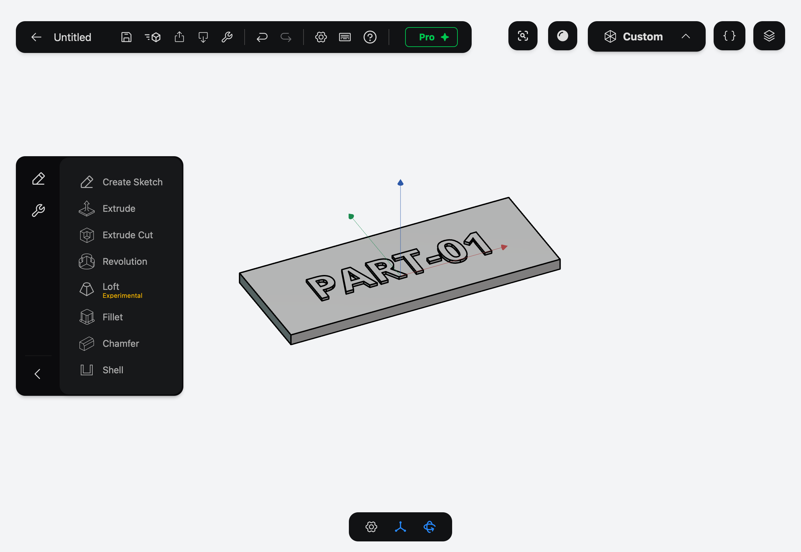

- **Engraved letters:** do the same, and use **Extrude Cut** with a depth less than the plate's thickness.

  

When you pick the letters, leave the counters out: the counter of an "O" is part of the plate, not of the letter.

### A plate with cut-through letters

Draw a [Rectangle](../rectangle/index.md) around the text in the same Sketch. The area around the letters becomes one Sketch Face with the letters as holes. Extrude that face and you get a plate with the letters cut through it.

In the picture, the top line is in Noto Sans Bold: the counters of P, R, O and B are separate faces, so they are left out and the holes are solid shapes. The bottom line is in Allerta Stencil: its counters are part of the plate, so the letters read correctly.

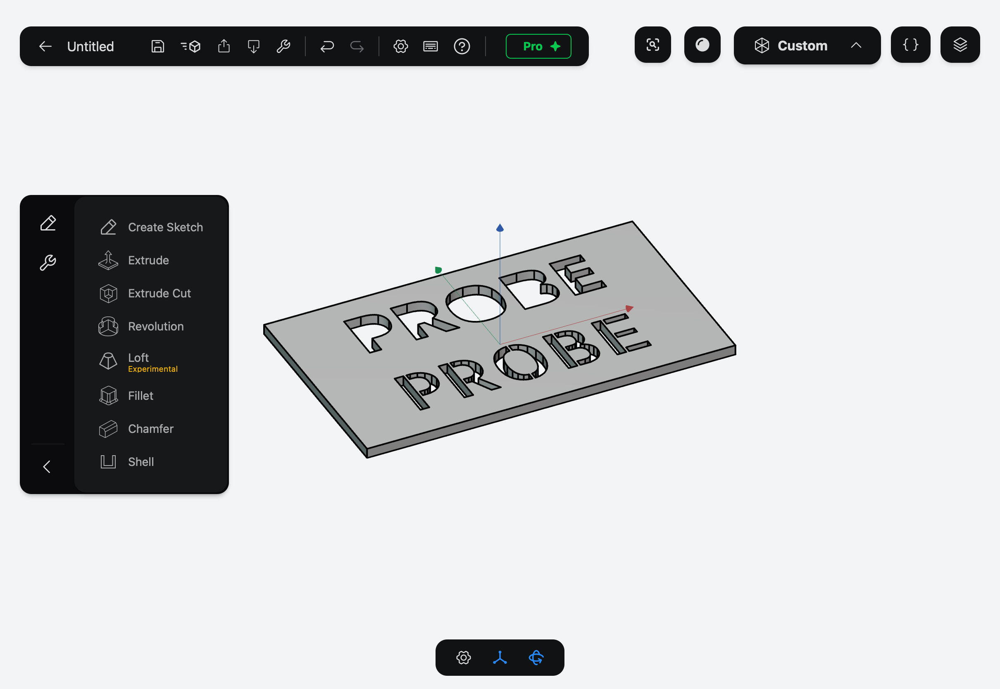

## Mirrored text for stamps

A stamp or a mold needs its text back to front, so it reads correctly once printed. Use [Mirror (Sketch)](../mirror-sketch/index.md) (Pro):

1. Draw a line to mirror across, then open **Mirror (Sketch)**. To pick the text, tap its baseline, the dashed line under the letters.

   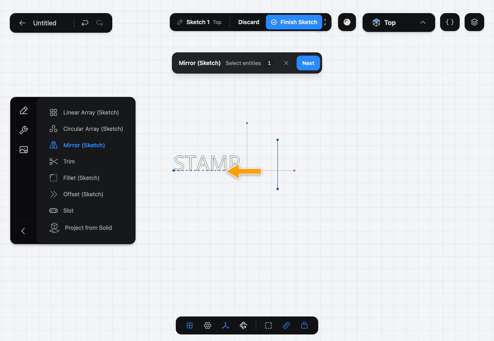

2. Tap **Next**, tap the mirror line and tap **Apply**. The copy is mirror-image text of its own. It stays the mirror image of the original's position: move or turn the original and the copy follows. Its words, font and Cap Height don't follow: to change them, double-tap the copy.

   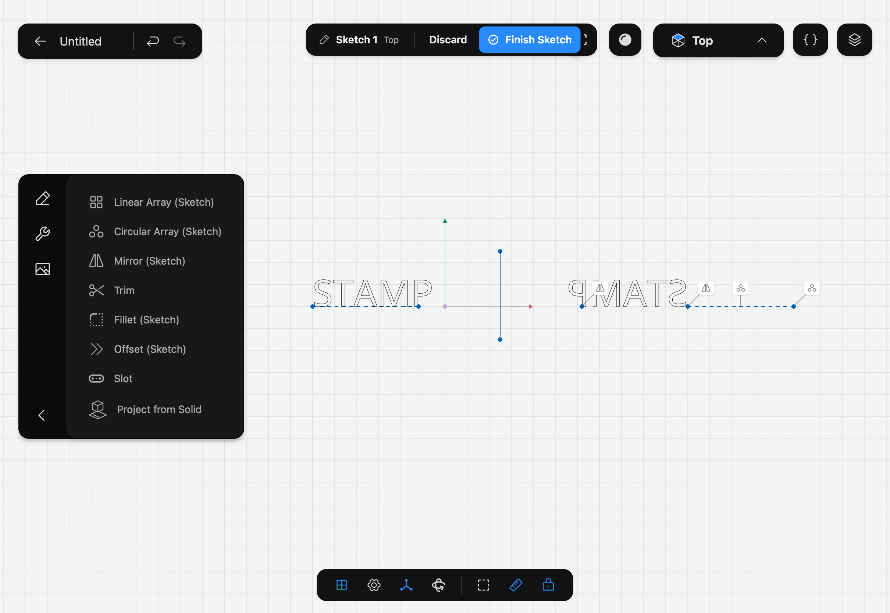

## Rows and rings of text

[Linear Array](../linear-array/index.md) and [Circular Array](../circular-array/index.md) (Pro) copy text too: pick its baseline as the shape to copy. Each copy is a Text of its own with the same words, font and Cap Height, and stays in the pattern. [Offset (Sketch)](../offset-sketch/index.md), [Fillet (Sketch)](../fillet-sketch/index.md) and [Trim](../trim/index.md) leave text alone.

## Common problems

- **"Some characters aren't available in this font."** The font has no letter for some of what you typed, such as an emoji or a script it doesn't cover. Those characters are left as blank space. Remove them or pick another font: the Noto fonts cover the most.

  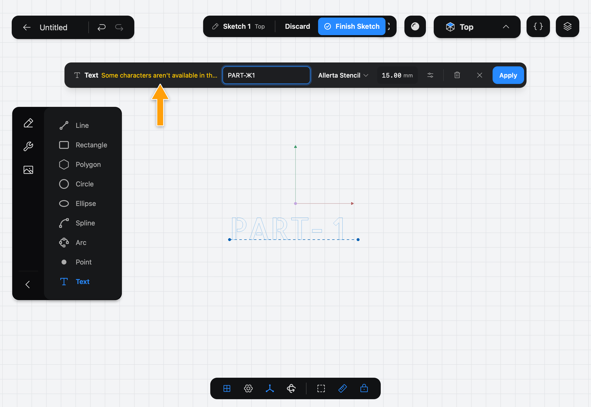

- **"These characters couldn't be built and were left out":** the shape of those letters failed. The rest of the text is still built. Try another font or a larger Cap Height.
- **The centers of O, A or R are missing from a cut-through plate:** that's the counters falling out. Use Allerta Stencil.
- **Tapping a letter selects nothing:** the letters can't be selected while you edit the Sketch. Double-tap them to change the text, or tap the baseline to select the text.
- **The text is at an angle:** drag the end of the baseline to turn it, or make the baseline horizontal with a Constraint.
- **Letters run together into one Sketch Face:** letters that touch or overlap are joined. Raise **Letter Spacing**.

> [!NOTE]
> **On Mac:** click wherever this page says tap, and type the text with the keyboard.
